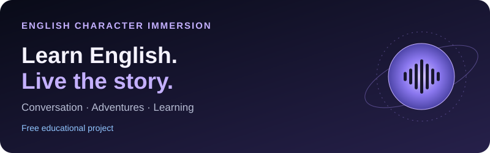

# English Character Immersion

[Español](README.md)

Practise English in your own ChatGPT: talk to characters, play narrative adventures, learn with a teacher and receive feedback tailored to your level.

## [🚀 Start practising English](https://palaciomemoriacodigo.github.io/english-character-immersion/en.html)

**Open the guided setup website.** It walks you through each step with illustrations, a copy-instructions button and a direct download for the only source file you need. No programming, software installation or GitHub account required.

You need a ChatGPT account with access to Projects. Practise by typing or using voice where available.

| Activity | Try saying… |
| --- | --- |
| Character conversation | “I want to talk to Sunny.” |
| English teacher | “I want to practise prepositions.” |
| Narrative adventure | “I want to start an adventure with Nephis.” |
| Feedback | “What did I get wrong today?” |

> **Next update:** 13 December 2026 (planned).

## Help and documentation

- [Alternative illustrated installation guide](docs/en/START_HERE.md) if the website is unavailable.
- [User guide](docs/en/USER_MANUAL.md) and [update safely](docs/en/UPDATE_GUIDE.md).
- [Developer documentation](docs/DEVELOPERS.md) and [changelog](CHANGELOG.md).

> Public test candidate. Browser tests passed; full live ChatGPT acceptance and distribution rights remain under review.

## Licensing and legal notice

Free, independent, unofficial educational project with no commercial purpose on the part of its maintainer.

| Material | License |
| --- | --- |
| Original software within the defined scope | [MIT](LICENSES/MIT.txt) |
| Original educational content within the defined scope | [CC BY-NC 4.0](LICENSES/CC-BY-NC-4.0.md) |
| Franchise dossiers, RPG material and protected third-party content | Excluded; no license granted |

Reuse original software and adapt original educational material under their respective license terms. Third-party characters and settings remain with their rightsholders; rights review is pending.

[Full scope](LICENSE) · [Legal notice and contact](NOTICE.md) · [Privacy](PRIVACY.md) · [Rights review](docs/RIGHTS_REVIEW.md).
