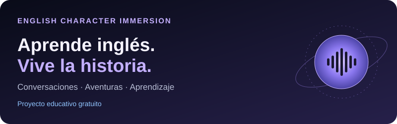

# English Character Immersion

[English](README.en.md)

Practica inglés en tu propio ChatGPT: conversa con personajes, vive aventuras narrativas, aprende con un profesor y recibe correcciones adaptadas a tu nivel.

## [🚀 Empezar a practicar inglés](https://palaciomemoriacodigo.github.io/english-character-immersion/)

**Abre la guía de instalación.** Te acompaña paso a paso con imágenes, un botón para copiar las instrucciones y otro para descargar el único archivo necesario. No necesitas saber informática, instalar programas ni crear una cuenta de GitHub.

Solo necesitas una cuenta de ChatGPT con acceso a Proyectos. Puedes practicar por escrito o por voz si tu cuenta lo permite.

| ¿Qué puedes hacer? | Prueba a decir… |
| --- | --- |
| Conversar con personajes | «Quiero hablar con Sunny». |
| Practicar con un profesor | «Quiero practicar las preposiciones». |
| Vivir una aventura | «Quiero empezar una aventura con Nephis». |
| Revisar tus errores | «Dime en qué me he equivocado hoy». |

> **Próxima actualización:** 13 de diciembre de 2026 (prevista).

## Ayuda y documentación

- [Guía alternativa de instalación con imágenes](docs/es/START_HERE.md), si la web no está disponible.
- [Manual de usuario](docs/es/USER_MANUAL.md) y [cómo actualizar sin perder tus datos](docs/es/UPDATE_GUIDE.md).
- [Documentación para desarrolladores](docs/DEVELOPERS.md) e [historial de cambios](CHANGELOG.md).

> Versión pública de prueba. Las pruebas de navegador han pasado; la experiencia completa en ChatGPT y los derechos de distribución siguen pendientes de revisión.

## Licencias y aviso legal

Proyecto educativo gratuito, independiente y no oficial, sin finalidad comercial por parte de su mantenedor.

| Material | Licencia |
| --- | --- |
| Código original incluido en el alcance | [MIT](LICENSES/MIT.txt) |
| Contenido educativo original incluido en el alcance | [CC BY-NC 4.0](LICENSES/CC-BY-NC-4.0.md) |
| Perfiles de personajes, RPG de franquicias y material protegido de terceros | Excluido; no se concede licencia |

Puedes reutilizar el código y adaptar el material educativo propio conforme a sus respectivas licencias. Los personajes y universos de terceros pertenecen a sus titulares; su revisión de derechos sigue pendiente.

[Alcance completo](LICENSE) · [Aviso legal y contacto](NOTICE.md) · [Privacidad](PRIVACY.md) · [Revisión de derechos](docs/RIGHTS_REVIEW.md).
