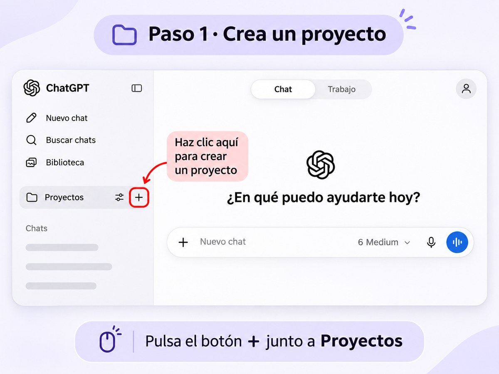
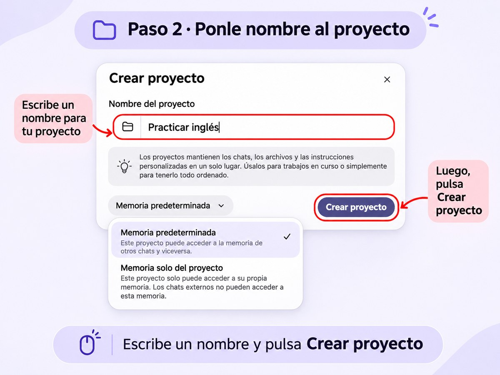
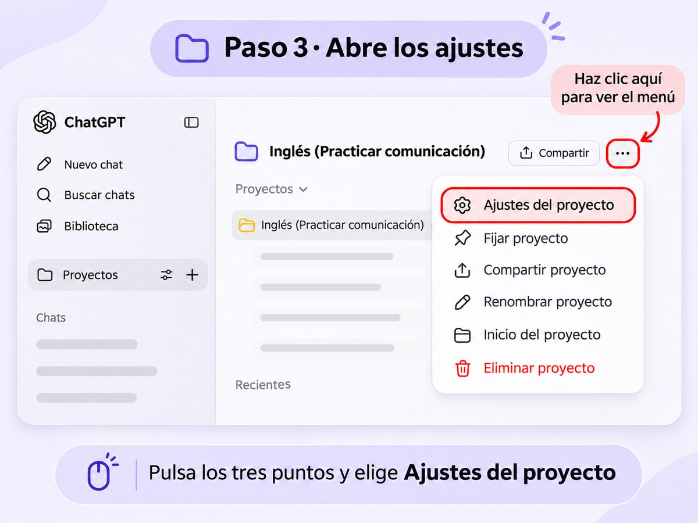
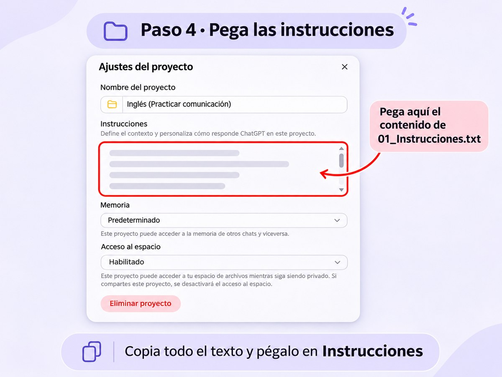
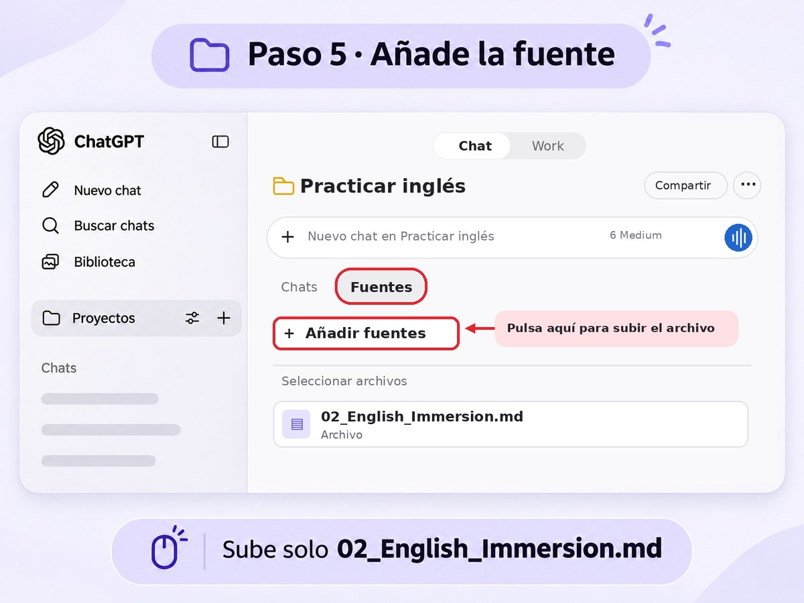
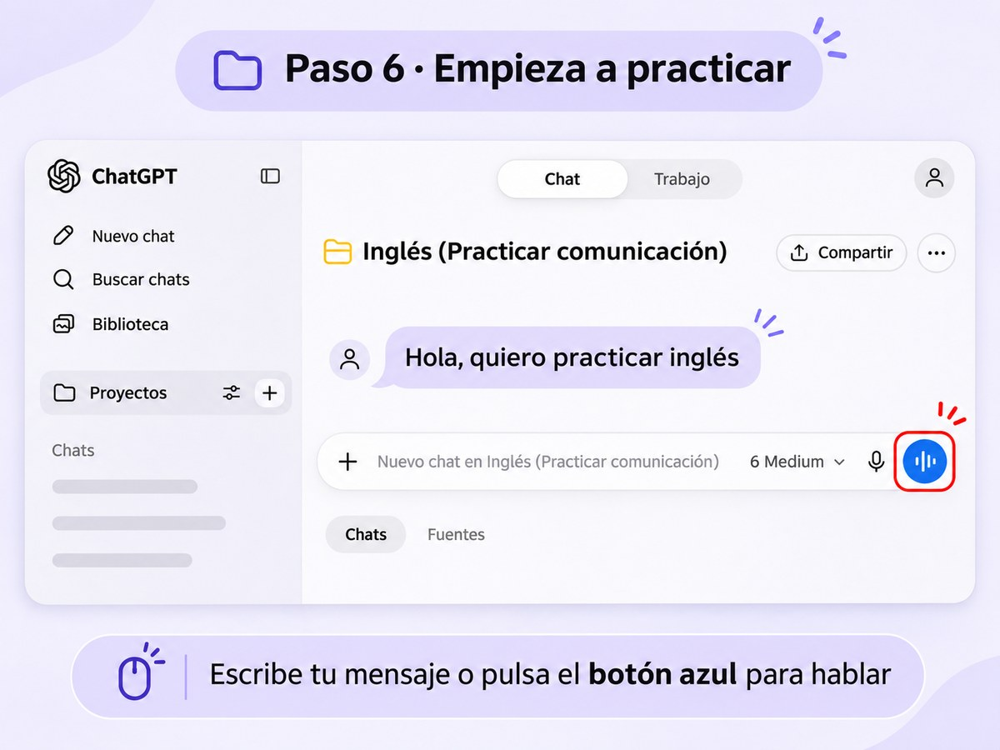

# Alternative installation guide

[Back to home](../../README.en.md) · [Guía en español](../es/START_HERE.md)

**Practise English by speaking, not memorising word lists.**

Would you like to talk in English, get help with mistakes and experience an adventure with fictional characters? Turn your own ChatGPT into a personal practice space.

## [🚀 Start practising English](https://palaciomemoriacodigo.github.io/english-character-immersion/en.html)

**Open the guided setup website.** Copy the instructions and download the practice file directly, without navigating GitHub.

**Public test candidate:** GitHub Pages has completed deployment; independent access and full live ChatGPT testing remain to be verified. Licensing and distribution rights remain under review. If the website does not load, use the guide below. The installation illustrations are based on real Spanish-language interface references; they are generated illustrations, not exact screenshots.

## What can you do?

- **Chat:** talk to Lelouch, Sunny, Nephis, Izaya or Roxas.
- **Learn:** ask an English teacher for help with grammar, vocabulary or interviews.
- **Play:** experience a narrative adventure and make your own choices.
- **Improve:** get corrections and exercises based on observed mistakes.

## Start here · 6 steps

You only need a ChatGPT account with access to Projects. We recommend setting up on a computer first. The illustrated controls below use Spanish labels.

### Step 1 · Create a project

Open [**ChatGPT**](https://chatgpt.com/) and sign in. Find **Projects** (Proyectos) in the sidebar and select **+**.

### Step 2 · Name your project

Name it **English practice**, or choose your own name. Select **Create project** (Crear proyecto). You may select project-only memory if available and you want to keep practice separate from other chats.

Keep your project private; there is no need to share it.

### Step 3 · Open project settings

Open your project, select the **three-dot menu ···**, and choose **Project settings** (Ajustes del proyecto).

### Step 4 · Copy and paste the instructions

**[Open the prepared instructions](../../empezar/01_Instrucciones.txt)**

Copy all the text using the copy icon in the file toolbar, or download and open the text file. Paste it into **Instructions** (Instrucciones) in your ChatGPT project settings. Save if prompted and check that the text remains.

### Step 5 · Add the practice file

**[Open and download the practice file](../../empezar/02_English_Immersion.md)**

Select **Download raw file** in the file toolbar. Keep the original filename. In ChatGPT, select **Sources** (Fuentes), **Add sources** (Añadir fuentes), and upload **02_English_Immersion.md**.

> Only upload this file. The text from step 4 belongs in the Instructions field, not in Sources.

### Step 6 · Start practising

Open a new chat inside the project. If your account offers reasoning levels, Medium is an optional example, not a requirement. Type or use the voice button if available.

### Try saying

> I want to talk to Sunny.
>
> I want to practise prepositions.
>
> I want to start an adventure.
>
> That's all for today. Can you tell me what I got wrong?

## Frequently asked questions

**Do I have to pay?**

Setup uses just one source. Check if Projects are available on your account. Practise by typing if voice is unavailable or you reach its limits.

**Do I need to know English already?**

No. Ask for simpler English, slower speech or Spanish explanations when needed.

**How do I keep my progress?**

Ask for a report at the end and keep it privately. A farewell in RPG prepares a copyable checkpoint unless declined. Keep it privately and paste it in the next chat if needed. Continuity between chats is not guaranteed.

**What if my screen looks different?**

Button names, model choices and locations may vary by account and device. See the [official Projects guide](https://help.openai.com/en/articles/10169521-projects-in-chatgpt).

---

[Update guide](../../docs/en/UPDATE_GUIDE.md) · [User guide](../../docs/en/USER_MANUAL.md) · [Privacy](../../PRIVACY.md) · [Developer documentation](../../docs/DEVELOPERS.md) · [Landing preview and publishing (Spanish maintainer guide)](../../docs/es/LANDING.md)

Independent, unofficial educational fan project. Third-party characters and settings remain with their respective owners. MIT and CC BY-NC 4.0 cover only specified original material; third-party distribution rights remain under review: [rights notice](../../NOTICE.md) and [license](../../LICENSE).
