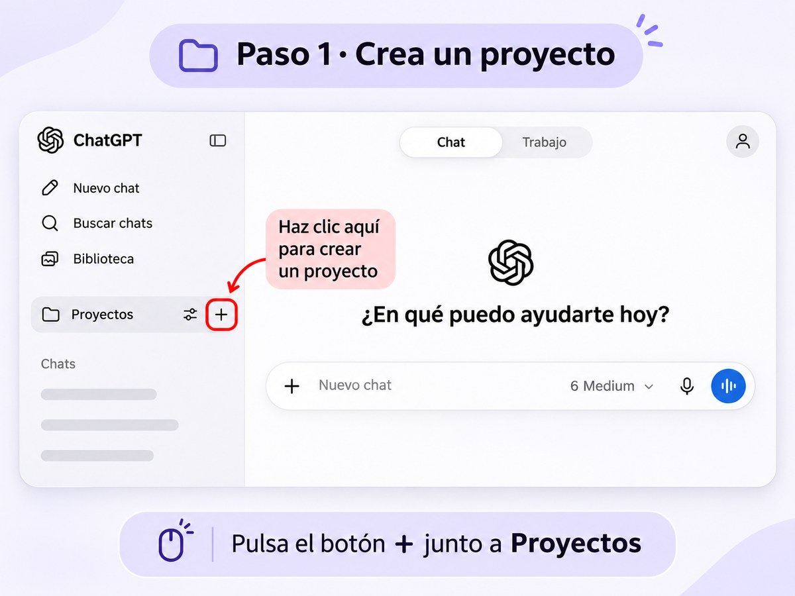
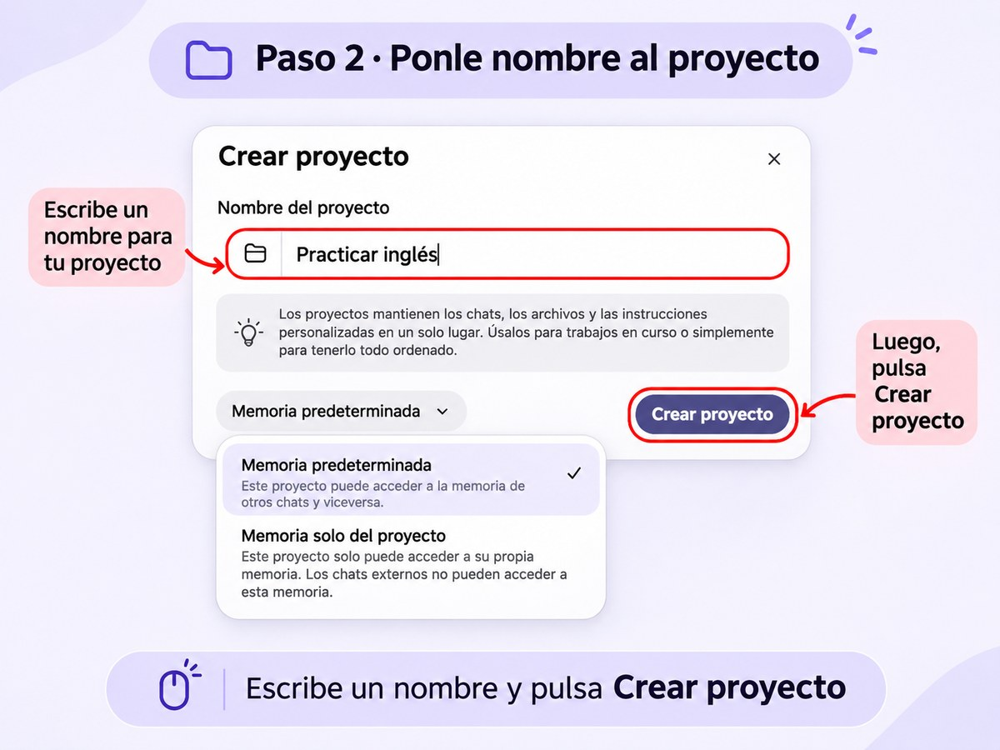
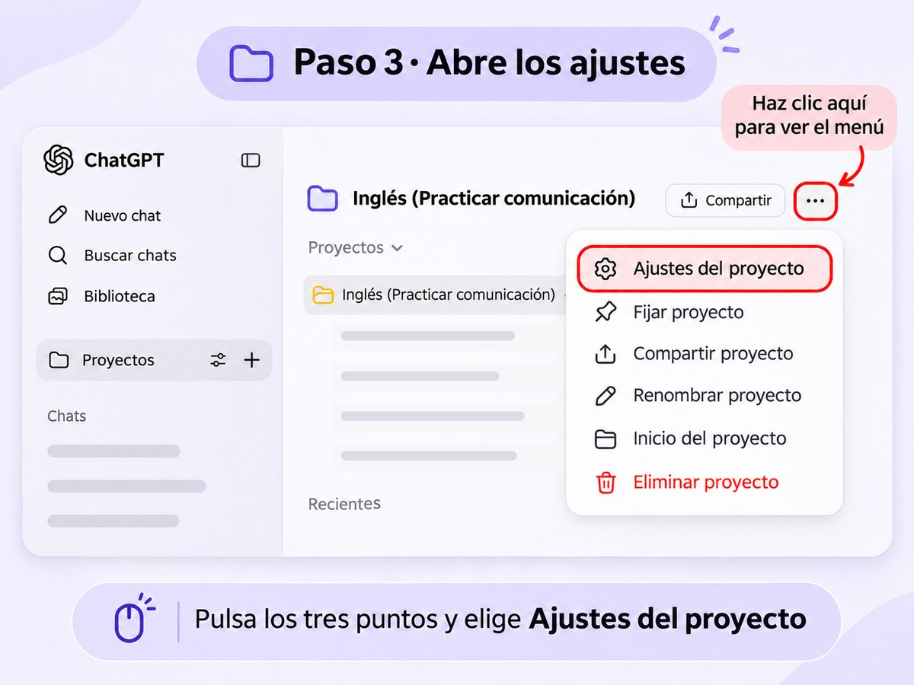
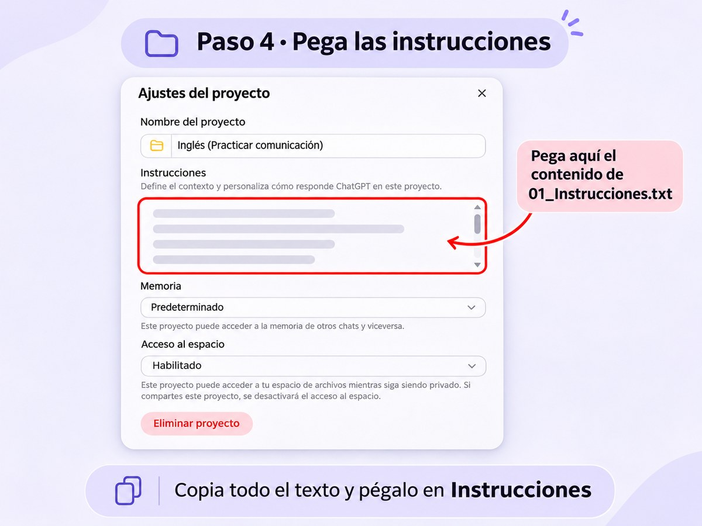
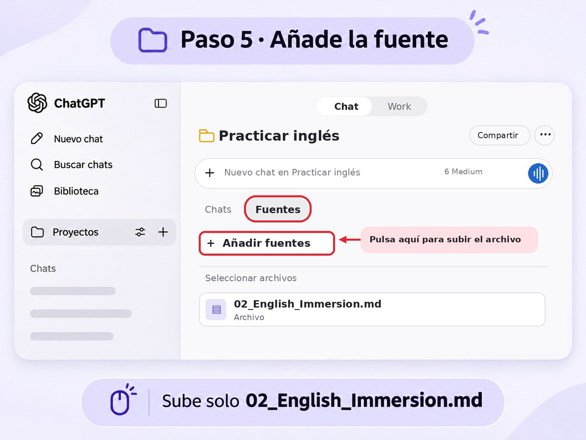
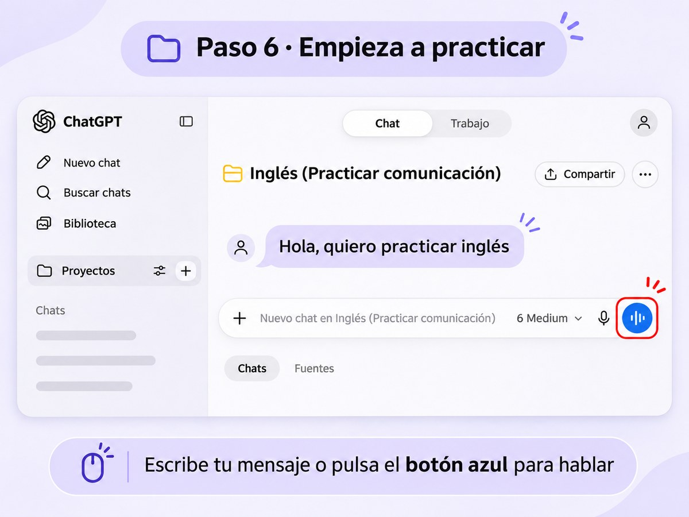

# Guía alternativa de instalación

[Volver al inicio](../../README.md) · [English guide](../en/START_HERE.md)

**¿Y si pudieras practicar inglés hablando de las cosas que te gustan?**

Con English Character Immersion puedes convertir tu ChatGPT en un espacio personal donde conversar con personajes, vivir aventuras, practicar con un profesor y aprender de tus errores.

Solo necesitas tu cuenta de ChatGPT. No tienes que instalar programas ni saber informática.

**Alcance de la beta:** puedes conversar con Sunny, Nephis, Lelouch, Izaya y Roxas. El modo RPG está configurado únicamente para Sunny y Nephis (por separado o juntos), con aventuras originales no canónicas en el universo de Shadow Slave. Lelouch, Izaya y Roxas disponen de perfiles de conversación; sus entornos, habilidades y mecánicas RPG aún no están configurados.

## [🚀 Empezar a practicar inglés](https://palaciomemoriacodigo.github.io/english-character-immersion/)

**Abre la web de instalación guiada.** Podrás copiar las instrucciones y descargar el archivo de práctica directamente, sin navegar por GitHub.

> Versión de prueba pública. GitHub Pages ha completado el despliegue; la comprobación externa y las pruebas completas en ChatGPT siguen pendientes. Se aplican licencias diferenciadas al material propio; los derechos de distribución de franquicias siguen en revisión. Si la web no carga, utiliza la guía de abajo.

## Empieza aquí · 6 pasos

No necesitas conocimientos informáticos. Solo crearás un proyecto, copiarás un texto y subirás un archivo. Haz la primera configuración desde un ordenador.

### Paso 1 · Crea un proyecto

Entra en [**ChatGPT**](https://chatgpt.com/) e inicia sesión. En el menú lateral, localiza **Proyectos** y pulsa el botón **+**.

### Paso 2 · Ponle nombre al proyecto

Escribe **Practicar inglés** (o el nombre que prefieras) y pulsa **Crear proyecto**. Si quieres separar tu práctica de otros chats, puedes elegir **Memoria solo del proyecto**, si está disponible.

No necesitas compartir el proyecto con nadie.

### Paso 3 · Abre los ajustes

Entra en tu proyecto, pulsa los **tres puntos ···** y elige **Ajustes del proyecto**.

### Paso 4 · Copia y pega las instrucciones

**[Abrir el texto de las instrucciones](../../empezar/01_Instrucciones.txt)**

En el enlace anterior, pulsa el icono de copiar contenido (dos hojas superpuestas) o descarga el texto, ábrelo y cópialo entero.

Vuelve a ChatGPT y pega el texto completo en el campo **Instrucciones** de los ajustes de tu proyecto. No necesitas traducirlo ni modificarlo. Guarda si aparece esa opción y comprueba que el texto sigue ahí.

### Paso 5 · Añade la fuente

**[Abrir y descargar el archivo de práctica](../../empezar/02_English_Immersion.md)**

Abre el enlace y pulsa el icono de descarga (**Download raw file**). Guarda el archivo con su nombre original.

En tu proyecto de ChatGPT, abre **Fuentes**, pulsa **Añadir fuentes** y selecciona el archivo **02_English_Immersion.md** de tu carpeta de descargas.

> Solo necesitas subir ese archivo. El texto del paso 4 se pega en Instrucciones, no se sube a Fuentes.

### Paso 6 · ¡Empieza a practicar!

Abre un chat nuevo dentro del proyecto. Si tu cuenta permite elegir el nivel de razonamiento, puedes usar **Medium**; no es obligatorio para utilizar el proyecto. Escribe o pulsa el botón de voz, si está disponible.

Di o escribe:

> Hola, quiero practicar inglés.

¡Listo! Ya puedes conversar, jugar o aprender con un profesor sin volver a configurar el proyecto.

---

## ¿Qué puedes hacer dentro del proyecto?

| Actividad | Qué puedes pedir |
| --- | --- |
| 💬 Conversar con personajes | «Quiero hablar con Sunny». |
| 🎓 Practicar con un profesor | «Quiero practicar las preposiciones». |
| ⚔️ Vivir una aventura | «Quiero empezar una aventura con Nephis». |
| 📝 Revisar tus errores | «Dime en qué me he equivocado hoy». |

Puedes conversar con Lelouch, Sunny, Nephis, Izaya o Roxas. También puedes elegir un profesor de inglés o pedir que te sorprenda.

No hace falta memorizar comandos. Habla de manera natural, en español o en inglés. Si algo te cuesta, pide una explicación más sencilla.

## Preguntas frecuentes

**¿Y si mi nivel de inglés es bajo?**

Puedes empezar desde tu nivel. Pide frases más fáciles, que hable más despacio o que te explique las palabras en español.

**¿Puedo utilizarlo por voz?**

Sí, cuando tu cuenta tenga acceso al modo voz. También puedes practicar por escrito. Los límites y las funciones disponibles dependen de tu cuenta.

**¿Cómo sé si estoy mejorando?**

Al terminar, puedes decir «Lo dejamos por hoy». El personaje te preguntará si quieres un informe. También puedes pedirlo directamente y leerlo en el chat. Guarda los informes y los resúmenes de tus aventuras de forma privada si deseas conservarlos. La continuidad automática entre chats no está garantizada.

**¿Necesito pagar o descargar más archivos?**

La instalación utiliza un solo archivo de fuentes y un texto de instrucciones. Comprueba que tu cuenta de ChatGPT tiene acceso a Proyectos. No necesitas Python ni otras herramientas.

**¿Mi pantalla es diferente?**

Las imágenes son ilustraciones generadas a partir de la interfaz real en español, con los controles destacados y sin títulos de chats privados. No son capturas exactas. Los nombres y la ubicación de los botones pueden variar por dispositivo y versión. Consulta la [ayuda oficial sobre Proyectos](https://help.openai.com/es-es/articles/10169521-projects-in-chatgpt).

---

[Manual de usuario](../../docs/es/USER_MANUAL.md) · [Actualizar sin perder datos](../../docs/es/UPDATE_GUIDE.md) · [Privacidad](../../PRIVACY.md) · [Información para desarrolladores](../../docs/DEVELOPERS.md) · [Página de instalación (vista previa y publicación)](../../docs/es/LANDING.md)

Proyecto educativo independiente y no oficial. Los personajes y universos de terceros pertenecen a sus respectivos titulares. MIT y CC BY-NC 4.0 se limitan al material original indicado en el alcance; la revisión de derechos de terceros sigue pendiente. [Aviso de derechos](../../NOTICE.md) · [Licencias](../../LICENSE).
